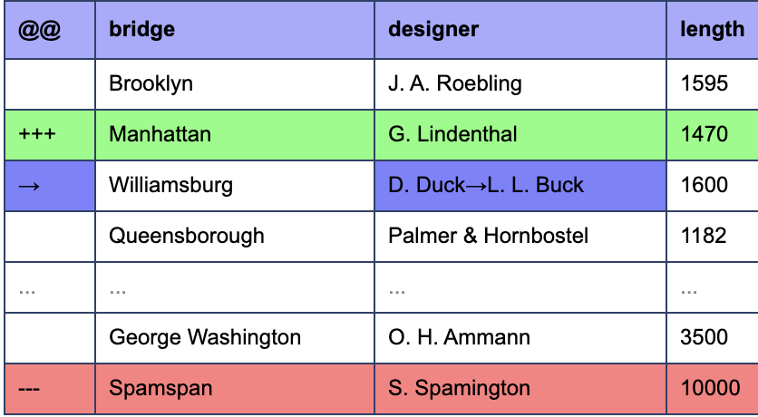

# Diff Tool to Compare Two Excel Spreadsheet Files

- in **Imitation** of https://www.textcompare.org/excel/
- github page https://yinger.github.io/ts-excel-compare/

## Development

Requires Node.js 22 (`volta` pins the version) and pnpm.

```bash
pnpm install

pnpm dev            # Vite dev server for src/ + Electron window (hot reload)
pnpm start          # Vite dev server only, http://localhost:3210
pnpm build          # type-check and build src/ into dist/
pnpm start:electron # show the built dist/ in an Electron window
pnpm typecheck      # type-check src/ and src-electron/
pnpm format         # format with Prettier
pnpm format:check   # verify formatting (CI friendly)
```

Code style is enforced by Prettier (`.prettierrc.json`): single quotes, tabs for indentation
(one tab renders as 3 spaces), no semicolons. `.editorconfig` and `.vscode/settings.json` pin
the same indent width for editors, since an editor decides how wide a tab is drawn.

`src-electron/main.mts` loads the URL of the Vite dev server when `VITE_DEV_SERVER_URL`
is set (that is what `pnpm dev` does, so `src/` is served with hot reload), and loads
`dist/index.html` otherwise.

Everything in the project is TypeScript: `src/` (renderer), `vite.config.mts` and
`src-electron/` (main process and dev launcher). The Electron files are executed directly by
Node's type stripping (Electron 44 bundles Node 24), so there is no build step for them;
`pnpm typecheck` checks both `tsconfig.json` and `src-electron/tsconfig.json`. Because of
that, `src-electron/` must stay erasable-syntax-only (no enums, namespaces or parameter
properties), which `erasableSyntaxOnly` enforces.

`pnpm install` also downloads the Electron binary (the npmmirror mirror configured in
`.npmrc` is used).

Electron 23 and newer require Windows 10+; Windows 7/8/8.1 support ended with Electron 22.
Keeping Electron recent also matters for the UI: the Handsontable theme uses `light-dark()`
and `color-mix()`, which Chromium 108 in Electron 22 silently drops, leaving the grid unstyled.

If Windows 7 support is ever needed again, pin `electron@22` and additionally:

- set `build.target: 'chrome108'`, since Vite 8 targets Chrome 111+ by default;
- set `css: { transformer: 'lightningcss', lightningcss: { targets: { chrome: 108 << 16 } } }`
  so Lightning CSS down-levels `light-dark()` (verified: all 74 occurrences are converted).
  The ~22 `color-mix()` declarations (borders, selection handle, shadows) cannot be
  down-leveled and will stay missing on Chromium 108.

## Libraries used in this Tool

- SheetJS https://sheetjs.com/
- Daff https://github.com/paulfitz/daff
- Handsontable https://handsontable.com/
- Antd https://ant.design/

## How to compare two excel files for differences?

Using this web tool, you can compare Excel document easily.
Just select first/original file in left window and second/modified file in right window. Your data will automatically be extracted. First sheet is automatically selected and you can change it in the dropdown.

Alternatively you can also copy and paste directly into left and right windows.
After that click on >>Diff<< button to find diff. The Diff data will be highlighted in a nice format.

For Excel export, you must have Excel or compatible spreadsheet application installed.

Otherwise you can also select all (`Ctrl-A`) and copy (`Ctrl-C`) and then paste in your spreadsheet software (`Ctrl-V`).

## What spreadsheet file formats does this Excel diff tool support?

- XLSX

## What does +++/— indicate?

- **+++** This has been added in second/modified file.
- **—--** This has been removed in second/modified file.
  

## What does → indicate?

- **→** This row exists in both files, but some of its cells changed; every changed cell shows both values (`old→new`).
  Rows that daff reports as removed (`---`) + added (`+++`) with the same unique key are merged into such a single `→` row,
  so set the header row number and pick the unique field(s) before clicking >>Diff<< if you want that.
